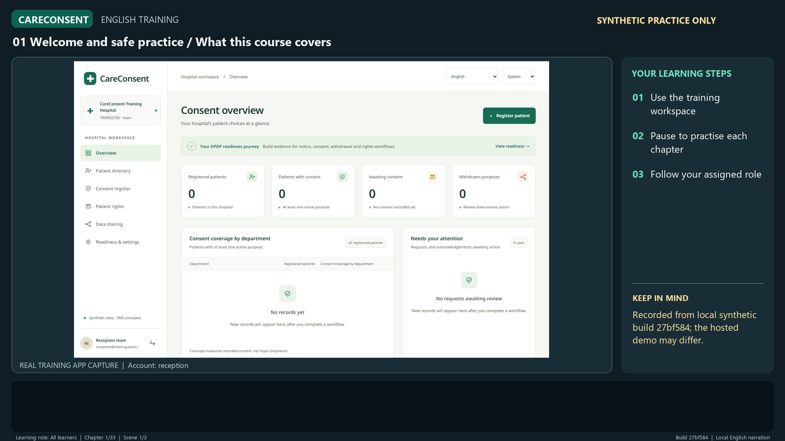

# CareConsent training

English beginner training for hospital staff, patients and administrators using CareConsent. This public repository contains the synthetic training course and its playback companions. Application source stays in its separate private repository.

**29 October 2026 edition:** 1 hour 4 minutes 13 seconds · 33 chapters · 104 scenes · English narration and 910 subtitle cues. Recorded against local application build `27bf584`; the hosted demonstration may show an earlier build.

[Download the video](https://raw.githubusercontent.com/cvpeceee/CareConsent-Training/training-en-2026-10-29-media/CareConsent-English-Training.mp4) · [Download the complete offline course](https://raw.githubusercontent.com/cvpeceee/CareConsent-Training/training-en-2026-10-29-media/CareConsent-English-Training-Package.zip) · [Release notes](https://github.com/cvpeceee/CareConsent-Training/releases/tag/training-en-2026-10-29)

## Watch and share

Share this repository or the release page; viewers do not need access to the application repository. The MP4 has English subtitles visible in the picture. Separate [SRT](CareConsent-English-Training.srt), [WebVTT](CareConsent-English-Training.vtt), [transcript](CareConsent-English-Training-Transcript.md) and [chapter timings](CareConsent-English-Training-Chapters.json) are included.

For the offline chapter player, download the **complete offline course**, extract all nine files together, and open `index.html` in a modern browser. It needs no server or external player service. If local browser playback is blocked, open the MP4 directly. The single MP4 download does not include the player or companions.

The checksum file covers the eight playback/reference files, excluding itself and the ZIP. The release notes record the ZIP's own SHA-256. Download links are pinned to this edition's media tag; `.gitattributes` preserves exact payload bytes. Earlier editions remain available through their release pages and tags.

## What changed

The first 24 chapters have been refreshed against the recorded build. They teach sign-in/MFA, preferences, registration, purpose choices, simulated OTP, patient receipts and verification, selective withdrawal, sharing and clinical evidence, guardians, patient requests, legal holds, incidents, retention, notice review/publication, administration, audit and operational boundaries.

New chapters 25–33 cover:

- Verified patient access, private activation handover, remote withdrawal and recovery; guardian/delegate authority and staff assignments.
- Personal/shared/no-phone reception, witnessed or paper evidence and emergency records.
- Notice/SMS delivery review, reconciliation, branch metadata/conflicts, nodes and managed operations.
- Disabled FHIR/custom OAuth and ABDM local-mock boundaries; language and reviewed-audio limits.
- The privacy workspace: inventories, flows, obligations, policies, governance, vendors, agreements, transfers, impact/risk assessments, retention and rights oversight, children, workforce training, reviews, marketing, security and breach evidence.
- Drafting, submission, independent MFA review, revision approvals, reports, export and hospital readiness gates.

Returning viewers can start at chapter 25 in the offline player, or chapter 31 for the privacy workspace. Every chapter can be selected independently.

The course combines actual synthetic application captures with narrated guidance and 17 explicitly labelled explainer scenes. It is a sequence of teaching screens, rather than continuous mouse recording. Explanations of API-only or unqualified integrations do not imply an available front-desk button or successful live connection.

## References and scope

Read [References and Scope](References-and-Scope.md), reviewed on 29 October 2026. It links the official DPDP Act, final Rules, commencement notification, corrigendum, subsequent Order and separate CERT-In directions. Commencement is phased. Configured demo retention guardrails and hospital service targets are not universal statutory deadlines.

All people, hospital records, evidence references and contact details shown are invented. Passwords, activation codes, authenticator material and other account secrets are masked. Simulated OTP and notification demonstrations send no real SMS or regulatory submission.

Remote patient withdrawal is shown for an already verified and activated account; a hospital visit is not required for that flow. Withdrawal in the register, legal record retention and verified downstream enforcement are separate outcomes. The hospital must confirm its actual identity checks, contact routes and connected-system behavior.

The new privacy registers support hospital evidence work. An approved internal record revision does not prove hospital-wide compliance or complete missing independent evidence. Live SMS/DLT and HIS qualification, managed infrastructure, reviewed languages/audio, independent security/accessibility assessment and hospital acceptance remain external release gates. Directory managers remain trusted identity roots with further privileged-lifecycle separation work documented in the application project.

Branch/node screens cover bounded consent metadata and managed withdrawal operations. They do not establish a general offline patient database or unrestricted multi-branch grants. FHIR/custom OAuth is disabled in this recording; ABDM examples use a local mock and do not establish NHA qualification. Training publication does not deploy the application or certify production readiness.

## Editions

Current: [`training-en-2026-10-29`](https://github.com/cvpeceee/CareConsent-Training/releases/tag/training-en-2026-10-29), local source build `27bf584`, references reviewed 29 October 2026.

Previous: [`training-en-2026-10-27`](https://github.com/cvpeceee/CareConsent-Training/releases/tag/training-en-2026-10-27), 34:45 / 24 chapters / 64 scenes. Its original media tag and downloads are preserved. Each edition is a fixed snapshot; later product or legal changes require a new reviewed release.
